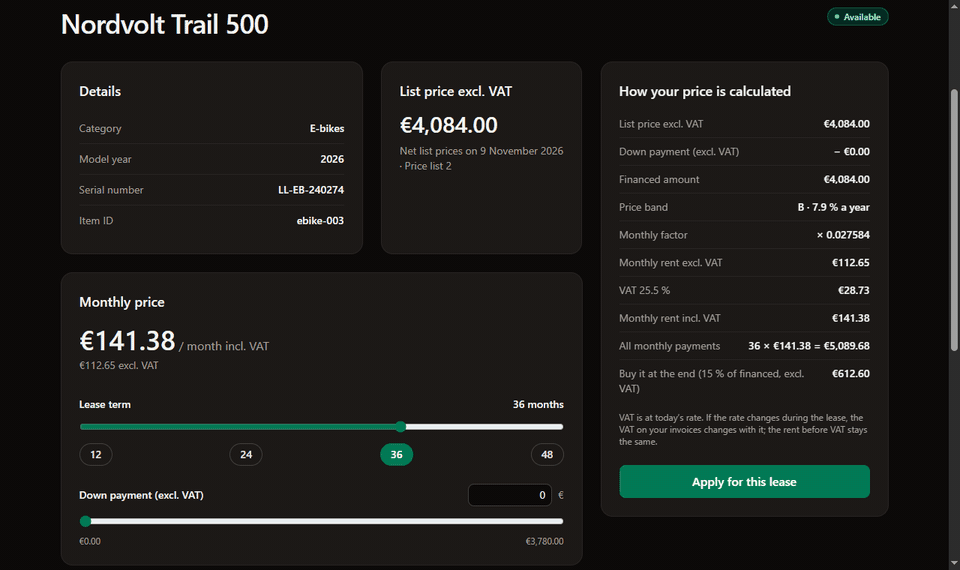
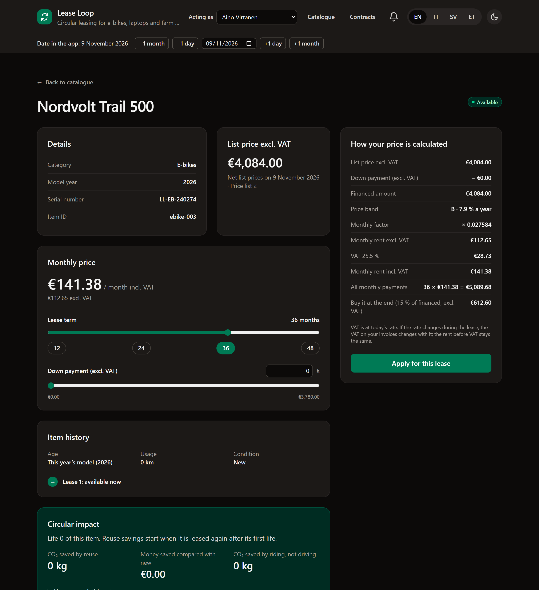
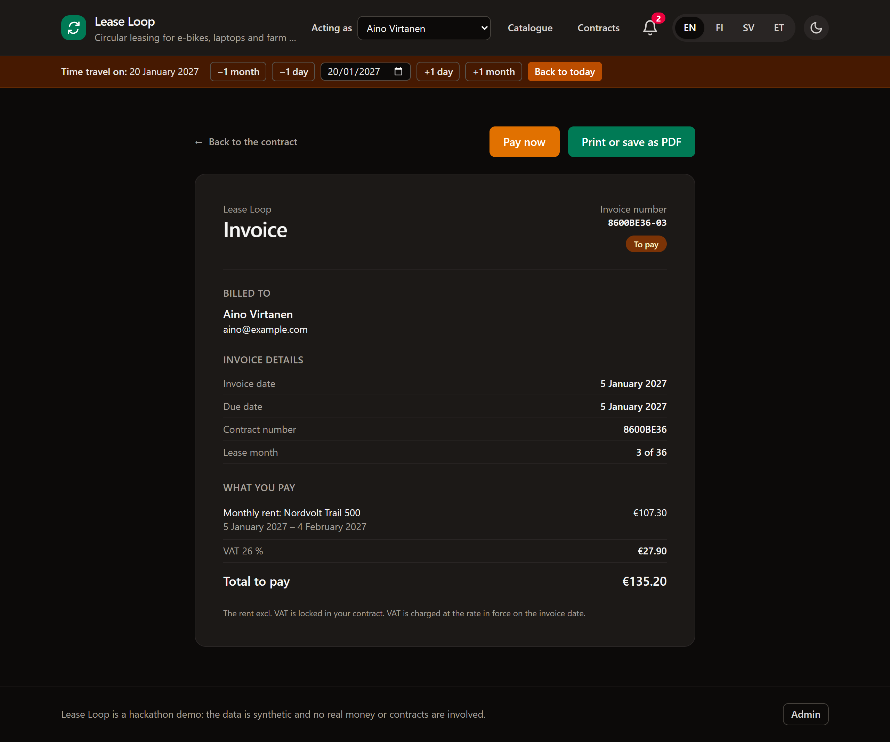
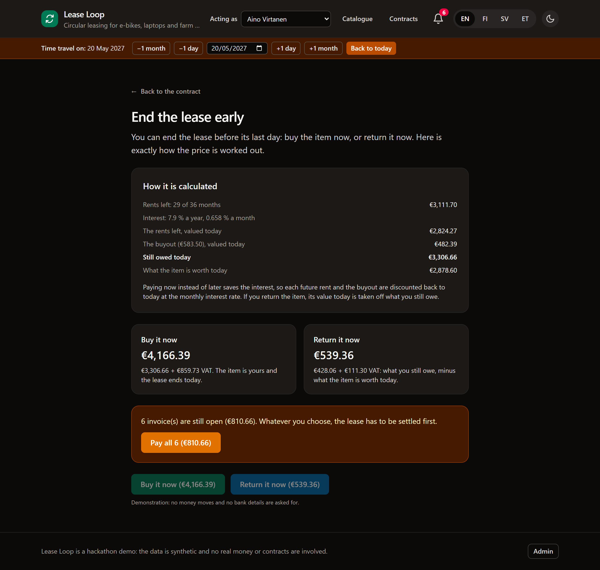
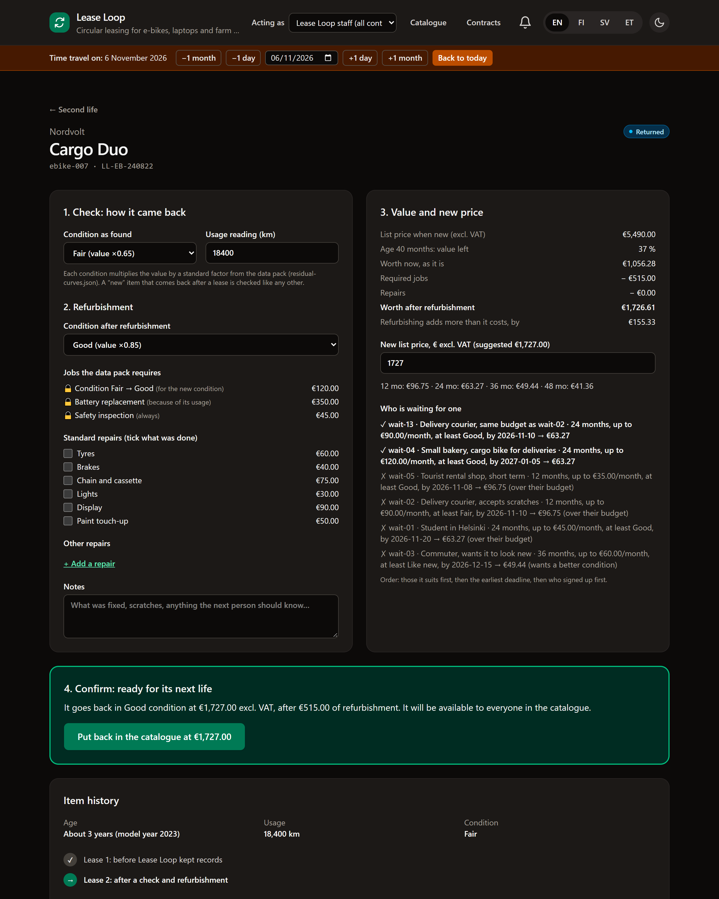
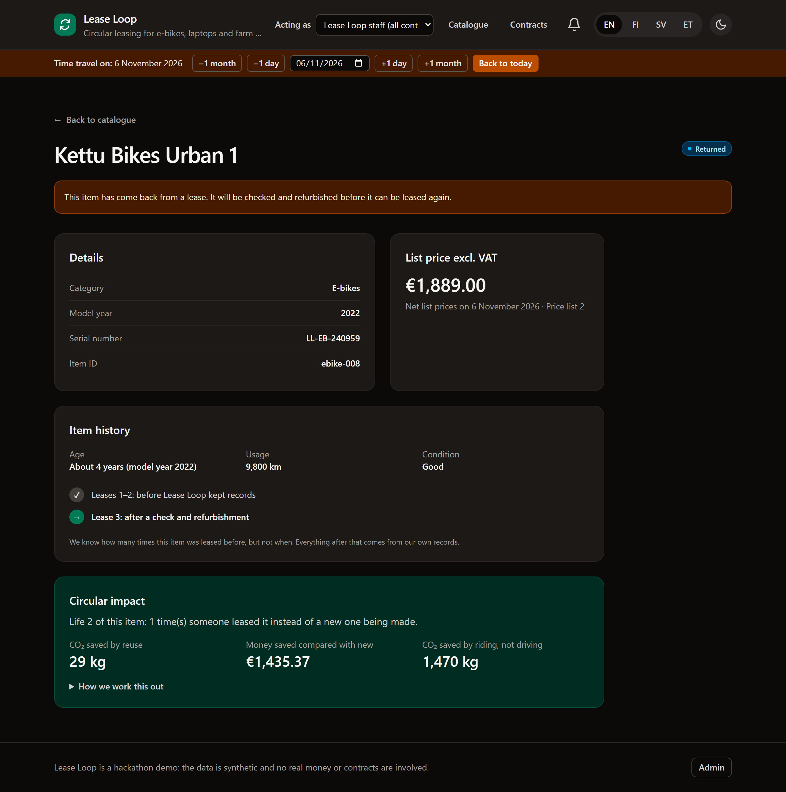
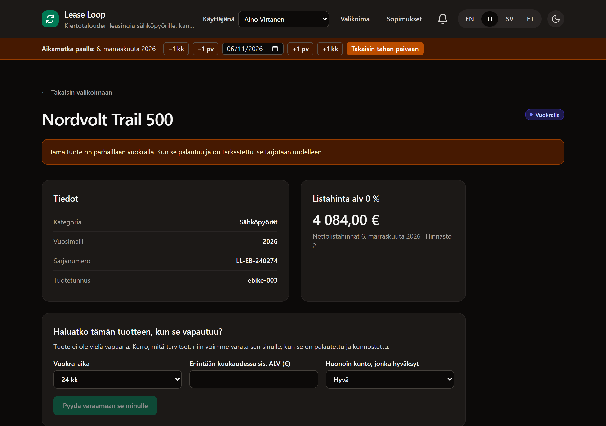

# Lease Loop

**One e-bike, laptop or tractor, three lives.**

Lease Loop is a circular leasing app. It takes an item from a price quote to a signed contract,
through every monthly invoice, to the end of the lease. Then it checks and refurbishes the item,
gives it a new price, and leases it to the next person on the waiting list.

Built in 24 hours by **Team LoopDeLoop** at the [Northfina × Hive Helsinki hackathon](CHALLENGE.md)
(5–6 Nov 2026).




There is no AI inside the app. Every number comes from rules, data and plain arithmetic, so every
number can be explained line by line.

---

## Highlights

|                                                                                                                                                                                                                    |                                                                                                                                                                                                                                |
| ------------------------------------------------------------------------------------------------------------------------------------------------------------------------------------------------------------------ | ------------------------------------------------------------------------------------------------------------------------------------------------------------------------------------------------------------------------------ |
| **Every price explained.** List price, down payment, price band, monthly factor, VAT and buyout, each on its own line.<br><br>                                          | **The price is locked, the tax is not.** VAT goes from 25.5 % to 26 % on 1 Jan 2027. The rent stays the same, and the invoice says why the total changed.<br><br> |
| **A fair early exit.** What's still owed is discounted at the contract's own interest rate, and returning the item takes off what it's worth today.<br><br> | **Second life.** A returned item is checked, refurbished and re-priced. The waiting list is ranked by who it actually suits.<br><br>                                    |
| **A passport for every item.** Its lives, its wear, and the CO₂ its reuse saved, scaled by how much life it has left.<br><br>                      | **Four languages, dark and light.** English, Finnish, Swedish and Estonian. Accessibility (WCAG 2.1 AA) is checked automatically in both themes.<br><br>                       |

And a **time-travel bar** in the header: jump to month 7 of a lease, or back to before it was
signed, and the whole app shows exactly what was true on that date.

---

## Try it

You need Node 22 and npm.

```bash
npm ci
npm run db:setup      # creates .env and a seeded SQLite database
npm run dev           # http://localhost:3000
```

`npm run db:reset` puts the database back to its starting state.

Two controls in the header drive the demo:

- **Acting as**: a demo login. Pick a customer (Aino, Mikko, Norvi, …) and the app prefills their
  answers and shows only their contracts and invoices. **Staff** sees everything.
- **Time travel**: set the app's date, forwards or backwards. State is replayed from dated records,
  and anything that happened after the chosen date is locked until you come back.

The **Admin** link in the footer has the totals, VAT changes, the fleet's CO₂ saving, signatures,
the second-life workbench and the audit log.

### A four-minute tour

| #   | Do this                                                                 | What you see                                                                                                      |
| --- | ----------------------------------------------------------------------- | ----------------------------------------------------------------------------------------------------------------- |
| 1   | Act as **Aino**, open **ebike-003** and move the sliders                | The monthly price and its plain-language breakdown update live                                                    |
| 2   | Apply, then sign                                                        | Questions appear only when they apply, each with "why we ask". The price is locked at signing                     |
| 3   | Time travel to **20 Jan 2027** and open the invoices                    | December at 25.5 % VAT, January at 26 %. Same rent, different tax, and the invoice explains it                    |
| 4   | Time travel to **20 May 2027**, then contract → **End the lease early** | The exit price, worked out line by line                                                                           |
| 5   | Act as **Mikko** (17) and apply for **laptop-008**                      | A kind, clear "no", with what a parent or guardian could do instead                                               |
| 6   | Act as **Staff**, Admin → Second life → **ebike-007**                   | Refurbish or not, a new price, and who on the waiting list gets it and why                                        |
| 7   | Open **ebike-008**                                                      | Its passport across three lives and the CO₂ it saved                                                              |
| 8   | Act as **Norvi**, apply for **ebike-004** and type a signatory's email  | The applicant can't sign for the company, so it waits for the person who can. Admin → **Signatures** to finish it |

---

## What's clever about it

### Lock the price, not the tax

The contract copies the net rent from the approved quote and never recalculates it. Each invoice
uses the VAT rate on its own date, rounded once to the cent, and warns before a change and explains
it after. Admin can add a future VAT change, and quotes, warnings and invoices follow it.
[`vat.ts`](src/domain/vat.ts), [`invoicing.ts`](src/domain/invoicing.ts)

### A fair early exit

_Still owed today_ is the remaining rents plus the buyout, each discounted back to today at the
contract's own interest rate: paying early shouldn't cost interest you no longer owe.

- **Buy now:** pay what is still owed.
- **Return now:** pay what is still owed minus what the item is worth today, never below zero.
- **Consistent:** in the last month, "buy now" is exactly the end-of-term buyout.
- **First month free:** returning before the second invoice costs nothing.

[`early-exit.ts`](src/domain/early-exit.ts)

### Second-life matchmaking

- **Value:** price at first lease × age curve × condition × usage.
- **Refurbishing:** required jobs come from the cost table, plus preset or custom repairs. The app
  shows whether refurbishing adds more value than it costs.
- **Who gets it:** first those it actually suits (the rent at their term fits their budget, and the
  condition meets their minimum), then the earliest deadline, then who signed up first.

[`second-life.ts`](src/domain/second-life.ts)

### Honest CO₂

A reuse life avoids making a new item, minus the refurbishment. A nearly worn-out item only
replaces part of a new one, so the saving is scaled by the life it has left, using the same factors
that price it. The figure under-counts rather than over-claims. Riding instead of driving is shown
separately, because a new bike would do that too. [`co2.ts`](src/domain/co2.ts)

### Also

- **Smart question flow:** questions are targeted by customer type, item, amount and earlier
  answers. Changing an earlier answer drops the ones that no longer apply. The decision is yes, no
  or "a person will check", with reasons. [`question-flow.ts`](src/domain/question-flow.ts)
- **Money that adds up:** integer cents everywhere, rounded once, half up. The invoices add up
  exactly to the contract total, tested across every term and a wide range of rents.
- **Calendar traps:** a lease from 31 Jan has its February invoice due on 28 Feb, or 29 Feb in a
  leap year. Months are clamped, never skipped.
- **Fleet leasing:** 2–20 items for a company, one decision and one all-or-nothing signature.
- **Who can sign:** if the applicant can't sign for the company, the application waits for the
  signatory, and the quoted price holds for the quote's 14 days.
- **Holds and pass-on:** ask for an item that's still leased, or pass yours on to someone else, who
  must accept.
- **Printable contract and invoices** (Print → PDF).

<details>
<summary><b>All ten judging scenarios, with the numbers</b></summary>

| Card               | Where to see it                                           | What happens                                                                                                                                       |
| ------------------ | --------------------------------------------------------- | -------------------------------------------------------------------------------------------------------------------------------------------------- |
| 1 Happy path       | ebike-003 on 5 Nov → apply → contract                     | 107.30 € a month + VAT 27.36 € = 134.66 €. The first three invoices and the total cost are shown                                                   |
| 2 Price lock       | laptop-004: quote on 5 Nov, sign on 6 Nov                 | The contract keeps the quoted v1 list price, shows today's 8 % lower v2 price, and says why                                                        |
| 3 Tax is not price | ebike-001 invoices                                        | December 25.5 %, January 26 %. The bill warns before the change and stops warning once it has happened                                             |
| 4 Calendar traps   | laptop-001 from 31 Jan 2026                               | Due 28 Feb 2026 and 29 Feb 2028 (a leap year)                                                                                                      |
| 5 Too young        | Act as Mikko → laptop-008                                 | A kind "no": under 18, with what a parent or guardian could do instead                                                                             |
| 6 Who can sign?    | Act as Norvi → ebike-004 → apply, then Admin → Signatures | It waits for the signatory's email, saved and with no invoices. The signatory signs (the contract goes on Norvi's account) or declines with a note |
| 7 Big ticket       | Act as Haapala → farm-002, 48 months, 20,000 € down       | 125,000 € financed brings in the big-deal questions. One owner is a politically exposed person, so a person must review it                         |
| 8 Early exit       | Aino, month 7 of 36                                       | 29 rents left. Still owed 3,306.66 €, the bike is worth 2,878.60 €, so returning it costs 539.36 € incl. VAT                                       |
| 9 Second life      | ebike-007, fair, 18,400 km                                | Refurbish to good. **wait-13** gets it: its 24-month rent fits the 90 € budget, while wait-02's 12-month rent doesn't                              |
| 10 Third life      | ebike-008                                                 | Passport plus CO₂: 2 reuse lives × 145 kg × 20 % life left = 59 kg. A naive count would claim 290 kg                                               |

</details>

---

## How it's built

```
src/domain/    the rules: pricing, VAT, invoicing, early exit, second life, CO₂, fleets, time travel
src/server/    database access; each write is one transaction with its audit row
src/app/       pages (/[locale]/…) and API routes (/api/…)
src/components UI
tests/e2e/     browser tests and the accessibility pass
data/          the organisers' synthetic data pack (unchanged)
```

- **Pure, tested domain logic.** Every business rule is a pure function in
  [`src/domain/`](src/domain/) with its own tests. It never reads the clock: the date is passed in,
  which is what makes time travel possible.
- **Tests.** 509 unit and database tests (Vitest on a real SQLite test database), plus browser
  tests that drive headless Chrome through the scenarios and run axe-core on every main page in
  light and dark mode (`npm run test:e2e`).
- **Money in integer cents.** [`money.ts`](src/domain/money.ts) rounds once, half up.
- **Audit log.** Every change goes through `withAudit`, so the change and its audit row are written
  in one transaction.
- **API envelope.** Every route goes through `handleRoute` / `ok` / `fail`
  ([`api-response.ts`](src/server/api-response.ts)), so errors never leak.
- **CI on every push:** format, lint, types, files under 600 lines, a "no AI" check, coverage,
  build and browser tests. Conventional commits, with Husky hooks always on.

**Stack:** Next.js 16 (App Router), React 19, TypeScript, Tailwind CSS 4, Prisma 7 with SQLite,
Zod, Vitest.

### Known trade-offs

- **Item age** is counted from 1 July of the model year (the middle of the year, since only the
  year is known). The hosts' example used 1 January, which they said is fine if documented.
- **A battery replacement** resets the usage counter used for the value. Keeping a separate
  lifetime total for the passport is the next step.
- **The demo login is not security,** on purpose.

---

## Team LoopDeLoop

| Name          | GitHub                                           | Main focus                                                                                                     |
| ------------- | ------------------------------------------------ | -------------------------------------------------------------------------------------------------------------- |
| Armin Kuburas | [@ArminKuburas](https://github.com/ArminKuburas) | Catalogue, pricing, contracts, invoices, time travel, end of term, second life, early exit, CO₂, fleets, tests |
| Johnny Varila | [@zoni527](https://github.com/zoni527)           | The smart question flow and the application                                                                    |

The challenge brief is in [CHALLENGE.md](CHALLENGE.md), the rules in [RULES.md](RULES.md), and the
starter repo's README in [docs/STARTER_README.md](docs/STARTER_README.md). The data pack is
synthetic: no real customers, money or contracts.
